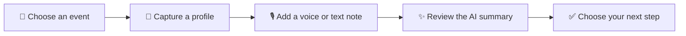

<h1>Syncy</h1>

<strong>The conversation ends. The follow-through starts.</strong>

Turn a post-event conversation into a contact you remember, a project that makes sense, and a next step you can act on.

<strong>🎙️ VOICE + TEXT &nbsp; · &nbsp; 🎯 PROJECT-AWARE &nbsp; · &nbsp; ✍️ HUMAN-REVIEWED</strong>

---

## ✨ The moment between meeting and follow-up

You meet someone interesting. You have a good conversation. Then the event ends, the profile link gets buried, and the details that would make a follow-up personal start to fade.

**Syncy keeps the useful parts together.** Capture who you met, add what you talked about while it is fresh, and turn that context into a thoughtful next step.

Built for independent consultants, freelancers, and founders who meet future clients and collaborators in person.

## 🧭 From hello to follow-through

### 01 · Start with the event

Choose an existing event or create one. Contacts stay connected to where you met, so the context is easy to find later.

### 02 · Capture the person

Scan a LinkedIn or Xing QR code, or paste the profile link it contains. Syncy saves the profile URL; it does not scrape the social profile.

### 03 · Save the conversation context

Record a short voice memo or type a note. Capture the detail you will want tomorrow: what they care about, what you offered, or what you promised to send.

### 04 · Review a useful contact brief

Ask Syncy to process the note. It can prepare an editable summary, key points, needs, a project suggestion with its reasoning, a next step and date, and a follow-up draft.

### 05 · Keep the relationship moving

Manage contacts in the dashboard, sort by the next follow-up, filter by event or project, and track the relationship through **To follow up**, **Followed up**, **Meeting set**, **Won**, or **Not relevant**.

## 🧠 A contact record with context

Syncy brings the person and the conversation into one place. A saved contact can include:

| | What it helps you remember |
| --- | --- |
| **👤 The person** | Their profile link, name, and the event where you met |
| **💬 The conversation** | An editable summary, discussion points, and stated needs |
| **🎯 The fit** | A suggested project, match reasoning, and confidence when there is a clear fit |
| **➡️ The next move** | An editable next step, optional due date, and follow-up draft |
| **📈 The relationship** | Your current follow-up stage and personal notes |

AI suggestions are there to save you a blank page. You can correct, replace, or leave any field empty before saving.

## 🗂️ Make project matching personal

Good project matching needs your context. Add projects directly in Syncy, or import the project names and descriptions you already keep in Notion.

1. Open **Projects** and connect your Notion workspace.
2. Share the database that contains your projects with the Syncy integration.
3. Choose that database and select **Import projects**.
4. Add clear project descriptions; Syncy uses them when suggesting a match for a new contact.

Notion is an optional, one-way source for projects. Imports happen when you request them. Contacts, notes, and edits stay in your Syncy workspace; Syncy does not write them back to Notion.

## 🔒 Your notes. Your judgment.

- **Nothing is sent on your behalf.** Follow-up drafts are yours to edit and send.
- **No profile scraping.** Syncy saves the URL provided by the QR code or pasted by you; it does not fetch profile details from LinkedIn or Xing.
- **Voice notes are for your own recollection.** Audio is sent to the transcription provider for processing and is not retained by Syncy.
- **You decide what gets processed.** When you request AI output, the note and relevant project context are sent to AI services. The transcript and saved contact details remain in your Syncy workspace.
- **Your workspace is account-scoped.** Your contacts and projects belong to your account.

## 🙋 Frequently asked questions

  
<strong>Do I need to connect Notion?</strong>

  
No. Create and manage projects in Syncy whenever you like. Notion import is optional.

  
<strong>Does Syncy send follow-up messages automatically?</strong>

  
No. Syncy creates an editable draft. You decide whether to use it and when to send it.

  
<strong>Does Syncy read or scrape LinkedIn and Xing profiles?</strong>

  
No. It uses the profile URL contained in the QR code or the link you paste. Add conversation details yourself in a note.

  
<strong>Is my voice recording stored?</strong>

  
Syncy sends the audio to its transcription provider and does not retain the audio file. The transcript is saved with the contact when you process the note.

  
<strong>Can I use Syncy without recording?</strong>

  
Yes. Type your note instead. You can also edit the transcript and AI-generated fields before saving.

  
<strong>Is Notion sync automatic or two-way?</strong>

  
No. You choose when to import projects from Notion. Syncy does not send contacts or your edits back to Notion.

## 🎬 See Syncy in action

Watch the product walkthrough, then choose **Settings → Quality → 1080p** in YouTube if that resolution is available for the video and your connection.

  <a href="https://youtu.be/J2zwPH9x2iY"><strong>▶ Watch the Syncy demo on YouTube</strong></a>

**Make the next conversation easier to remember.**

