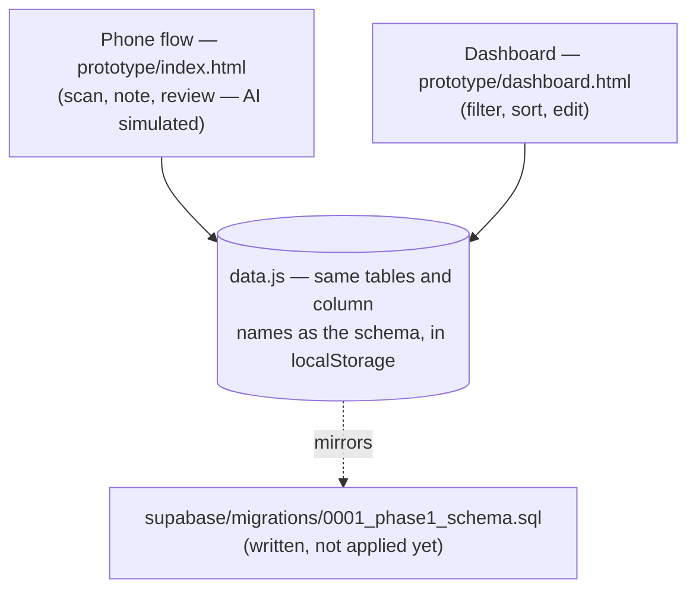
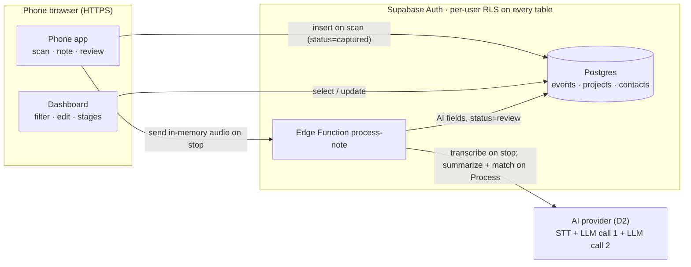
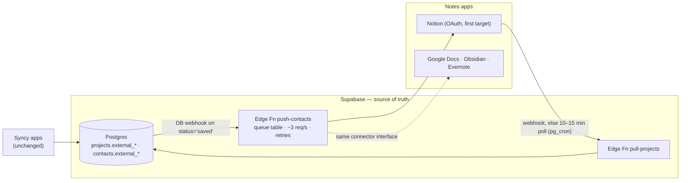

# Syncy — architecture: current → Phase 1 → Phase 2

> 24 Oct 2026 · Follows the Phase 1/2 decision in [PRD.md](../PRD.md) (update of 23 Oct) and [DATA_MODEL.md](DATA_MODEL.md).
> Diagrams are Mermaid — GitHub renders them inline.
> Standalone SVG exports for slides and docs: [diagrams/](diagrams/) — [user-journey.svg](diagrams/user-journey.svg) · [architecture-current.svg](diagrams/architecture-current.svg) · [architecture-phase1.svg](diagrams/architecture-phase1.svg) · [architecture-phase2.svg](diagrams/architecture-phase2.svg)

## 0. The three stages at a glance

| | Current (prototype) | Phase 1 (hackathon, Sat–Mon) | Phase 2 (post-hackathon) |
|---|---|---|---|
| Frontend | `prototype/index.html` + `dashboard.html` | same screens, real data | same + connector settings |
| Data | `data.js` arrays in localStorage | **Supabase** Postgres (RLS); voice audio sent to Edge Function, not stored | Supabase stays source of truth |
| AI | simulated | Edge Function: STT + 2 LLM calls | same |
| Projects | seeded in `data.js` | typed in the app, `projects` table | **pulled from Notion** (OAuth) |
| Contacts end up in | localStorage | Supabase (`status='saved'`) | Supabase **+ mirrored to Notion** |
| Auth | none | Supabase email + Google auth, RLS per user | account settings / more providers |

## 1. Current — clickable prototype

- Both pages read/write through four functions in `data.js` (`list / insert / update`), so a contact captured on the phone page appears in the dashboard.
- `data.js` uses **identical snake_case column names** to the SQL schema — the swap to the real backend replaces those four functions with supabase-js calls and touches no screen code ([DATA_MODEL.md §3](DATA_MODEL.md)).

## 2. Phase 1 — hackathon build (Supabase only)

**Request flow (maps to the statuses in the schema):**

1. **Scan** → client inserts the `contacts` row immediately: `source`, `profile_url`, `profile_slug`, name-from-slug, `event_id` → `status='captured'`. No external call; < 3 s (P-1).
2. **Note** → typed text stays in the form until Process. A voice memo is sent from memory to `process-note` on stop; Whisper returns a transcript for the editable note box. The audio is not saved.
3. **process-note Edge Function** (after Process, `status='processing'`): LLM call 1 → summary JSON; reads the user's `projects`; LLM call 2 → `project_id` suggestion + `match_reason` + `match_confidence` + `follow_up_draft`; writes results and note text back → `status='review'`. If the user picked a project at scan time (`project_set_by='user'`), the AI's suggestion does not overwrite it.
4. **Review** → user edits any field, assigns/changes project → `status='saved'`.
5. **Dashboard** → reads/updates the same rows: `stage`, `user_notes`, next steps. Pipeline `status` and relationship `stage` are deliberately separate columns.

**Security/cost:** AI + service keys live only in Edge Function env vars (AC-2.2, P-6); the browser holds only the public key. RLS and ownership checks isolate each account. Audio is forwarded to OpenRouter for transcription and discarded after the request; only transcript text is saved when the user taps Process. A transcription failure requires recording again.

## 3. Phase 2 — Notion and notes-app sync

Supabase remains the **source of truth**; external apps attach through per-app connectors with two operations: `pullProjects()` and `pushContact()` ([DATA_MODEL.md §5](DATA_MODEL.md)).

- **Projects in:** user connects Notion via OAuth and picks the projects page/database; `pull-projects` upserts on `(user_id, external_source, external_id)` and tracks Notion's `last_edited_time` in `external_updated_at`. Pages deleted in Notion → `archived=true` (contacts keep their link). Manual "Refresh" button as fallback.
- **Contacts out:** a database webhook on `contacts` (insert/update where `status='saved'`) triggers `push-contacts`: first write `pages.create` (store Notion page id in `external_id`), afterwards `pages.update`, then set `external_synced_at`. Writes go through a small queue because Notion allows ~3 req/s per integration.
- **Conflicts:** fields Syncy generates (summary, match, draft) — Supabase wins. Two-way fields (stage, user notes, next-step date) — last write wins via `updated_at` vs `last_edited_time`.
- **Other apps:** one connector module per app; Apple Notes has no public API (export/Shortcuts only).

**Also parked for Phase 2+** (from PRD §2 and the graded data-access table): Notion and notes-app sync, badge-photo/vCard capture if cut from Phase 1 (D4), opt-in Apify enrichment for the paid tier (D8), both-sided Syncy QR consent exchange (roadmap), and billing.

## 4. What changes between phases (build checklist view)

| Change | Current → Phase 1 | Phase 1 → Phase 2 |
|---|---|---|
| Swap `data.js` 4 functions for supabase-js | ✅ | — |
| Apply `0001_phase1_schema.sql` + ownership migration; users sign up themselves | ✅ | — |
| Build `process-note` Edge Function + prompts in repo | ✅ | — |
| HTTPS hosting for the two pages (D9) | ✅ | — |
| Notion OAuth + `pull-projects` / `push-contacts` + queue | — | ✅ |
| Connector interface for further apps | — | ✅ |
| Billing | — | ✅ |
