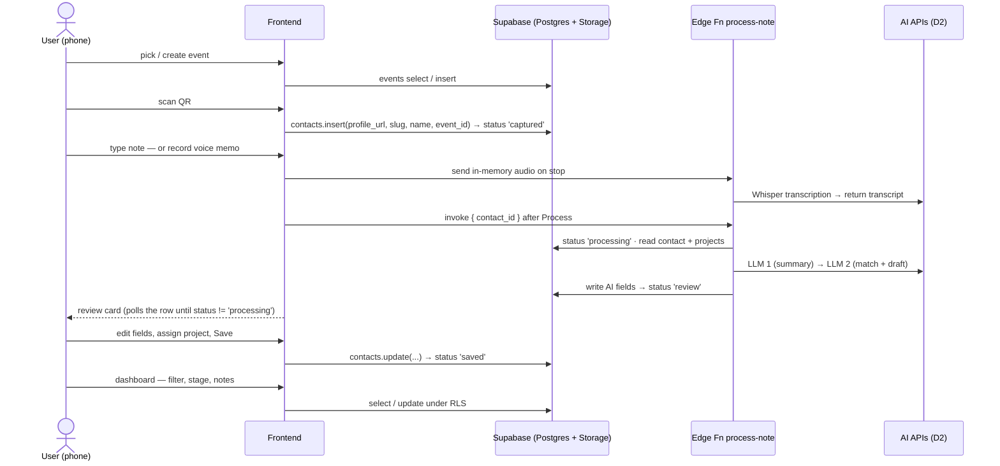

# Backend brief — build & wiring instructions (Phase 1)

> For Utkarsh (backend/AI) + Nodir (frontend wiring). 24 Oct.
> Architecture: [ARCHITECTURE.md §2](ARCHITECTURE.md) · data model: [DATA_MODEL.md](DATA_MODEL.md) · schema: [../supabase/migrations/0001_phase1_schema.sql](../supabase/migrations/0001_phase1_schema.sql) · AI prompts spec: [../PRD.md §9](../PRD.md)
> **Today's gate (M3, Sat midday): scan → note → AI fields visible on screen, with real AI calls.**
> Naming: the processing step appears here as the `process-note` Edge Function; if D1 lands on a separate server instead, the identical contract applies to `POST /api/contacts/:id/process` from the [IMPLEMENTATION_PLAN build map](../IMPLEMENTATION_PLAN.md) (step 6) — same inputs, statuses and writes.

## 1. The user journey, mapped to backend calls

| Step | Frontend does | Backend / service | Writes (see DATA_MODEL §1) |
|---|---|---|---|
| Pick event | list + create form | Postgres `events` | name, location, url, starts_on |
| Scan | html5-qrcode decode → regex slug → prettify name | Postgres `contacts` insert | source, profile_url, profile_slug, name, event_id, `status='captured'` |
| Quick project pick (optional) | one-tap chips | Postgres update | project_id, `project_set_by='user'` |
| Note | textarea **or** MediaRecorder | Whisper on stop; audio not stored | note_kind, note_text |
| Processing | invoke fn, then poll row every 2 s | **Edge Fn `process-note`** → AI APIs | summary, discussed, needs, project_id, match_reason, match_confidence, next_step, next_step_date, follow_up_draft, `status='review'` |
| Review & save | editable card | Postgres update | edited fields, `status='saved'`; project change → `project_set_by='user'` |
| Dashboard | table + drawer | Postgres select/update | stage, user_notes, any field |

## 2. Tools — what's connected, what's needed, where

| Tool / service | Used for | Where it runs | Key / setup | Owner | Status |
|---|---|---|---|---|---|
| **Supabase** (Postgres, Auth, Edge Functions) | contact data, RLS, AI pipeline; Storage remains for legacy audio cleanup | cloud | create project (EU region); anon key → client, service-role stays server-side (auto-injected in Edge Fns) | Utkarsh | ❌ create today |
| **supabase-js** | the 4 data calls from both pages | browser | CDN or npm; replaces `data.js` internals | Nodir + Utkarsh | ❌ |
| **Supabase CLI** | apply migration, deploy Edge Fn, set secrets | dev laptops | `supabase login`, `supabase link` | Utkarsh | ❌ |
| **OpenRouter** | LLM call 1 (summary) · LLM call 2 (match + draft) | **Edge Function only** — never the browser | `OPENROUTER_API_KEY`, `OPENROUTER_MODEL` | Utkarsh | Needs configuration |
| **OpenRouter Whisper** (`openai/whisper-1`) | Voice → text, German/English auto-detect | **Edge Function only** — never the browser | Reuses `OPENROUTER_API_KEY`; optional `WHISPER_MODEL` | Utkarsh | Same key as the LLM calls |
| **html5-qrcode** | camera QR decode (D3) | phone page | CDN script | Nodir | ❌ |
| **MediaRecorder API** | voice memo | phone page | built-in; send audio in memory to the authenticated Edge Function | Nodir | — |
| **HTTPS static hosting** (D9: Vercel/Netlify) | serve the two pages; camera+mic require HTTPS | cloud | one-command deploy | Utkarsh | ❌ today |
| GitHub | repo + submission (M6) | — | all 5 have access | Nodir | ✅ |
| ~~Notion API, OAuth, pg_cron, webhooks/queues~~ | **Phase 2 — do not set up this weekend** ([ARCHITECTURE.md §3](ARCHITECTURE.md)) | — | — | — | parked |

### Keys and env

| Where | Variable | Notes |
|---|---|---|
| Client (gitignored `config.js` or build env) | `SUPABASE_URL`, `SUPABASE_ANON_KEY` | anon key is safe client-side **because RLS is on** |
| Client | email/password or Google OAuth session | Supabase Auth provides the user token; RLS scopes all rows to `auth.uid()` |
| Edge Fn secrets | `OPENROUTER_API_KEY`, `OPENROUTER_MODEL` | one OpenRouter key covers LLM and Whisper STT; keys never in the repo |
| Edge Fn (auto) | `SUPABASE_URL`, `SUPABASE_ANON_KEY`, `SUPABASE_SERVICE_ROLE_KEY` | injected by Supabase |

## 3. Build & wiring order (do it in this sequence)

- [x] **1. Supabase data layer** and project URL/public-key config.
- [ ] **2. Apply schema + ownership migration.** Enable email confirmations, configure Google OAuth and URL redirects; verify two users cannot see each other's data.
- [x] **3. Account UI:** email sign-up/sign-in, Google sign-in, password reset, and sign-out. New accounts start empty.
- [x] **4. Authenticated data adapter:** load only after a valid Supabase session; writes and policies are scoped to the current user.
- [x] **5. Voice transcription on stop:** send in-memory audio to the authenticated Edge Function and return transcript without storing audio.
- [x] **6. Edge Fn `process-note`:** status/error path and real AI calls; voice transcript is already in the row before insights processing.
- [x] **7. Wire the AI** inside the function: Whisper STT → `note_text`; OpenRouter LLM 1 → summary JSON; active project read; OpenRouter LLM 2 → match + confidence + follow-up draft. If `project_set_by='user'`, keep the manual assignment. Invalid JSON retries once. Prompt text lives beside the Edge Function.
- [ ] **8. Idempotency:** re-invoking on the same contact must be safe (retry button).
- [ ] **9. Deploy** the static app to Vercel; set Supabase URL/public-key build variables and test on a phone.
- [ ] **10. Measure:** log seconds + tokens per step; hand real €/contact to Sadaf (AC-7.4). Then: 3 clean runs in a row (AC-4.1).

## 4. Acceptance checks for the wiring

| Check | Target | AC |
|---|---|---|
| Scan → row visible | < 3 s | P-1 |
| Note → review card | ≤ 15 s | P-2 |
| Unknown fields | empty, never invented | P-2 |
| AI/upload failure | message + retry, nothing lost | P-5 / FR-10 |
| Whole flow | no developer intervention | AC-3.2 |
| Stability | 3 runs in a row clean | AC-4.1 |
| Keys | none in repo or client bundle | AC-2.2 / P-6 |
